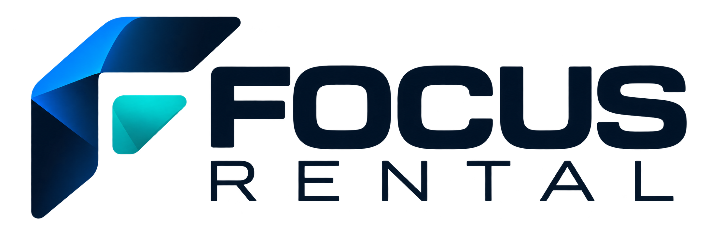

<p align="center">
  
</p>

<h1 align="center">Tu Comité API</h1>

<p align="center">
  <strong>Tu comunidad, mejor conectada.</strong><br />
  API empresarial para organizar las decisiones del comité de edificio<br />
  y mantener informada a toda la comunidad.
</p>

<p align="center">
  <a href="https://tucomite.cl">TuComite.cl</a>
  ·
  Un producto de
  <br /><br />
  
</p>

<p align="center">
  
  
  
  
  
</p>

---

## Qué es

**Tu Comité** es la plataforma digital de Focus Rental para comités de edificio: centraliza decisiones, avisos, documentos, temas, proyectos e informes en un solo lugar, con roles y permisos administrables.

Este repositorio contiene el **backend** (API REST) que alimenta:

| Aplicación | Descripción | Puerto local |
|---|---|---|
| `frontend/` | Sitio público | `5173` |
| `admin/` | Panel de administración | `5174` |
| `backend/` | API FastAPI | `8000` |

---

## Stack tecnológico

| Capa | Tecnología |
|---|---|
| Runtime | Python 3.13+ |
| Framework | [FastAPI](https://fastapi.tiangolo.com/) + Uvicorn |
| Validación / settings | Pydantic v2 · pydantic-settings |
| Persistencia | SQLAlchemy 2.0 · MySQL 8 · PyMySQL |
| HTTP cliente (tests) | httpx · TestClient |
| Pruebas | pytest · pytest-asyncio |

### Principios de diseño

- **Arquitectura por capas**: `endpoints → services → repositories → models`
- **Código y rutas de API en inglés**; el texto visible al usuario vive en los frontends
- **Patrones empresariales**: repository, policy de permisos, catálogo de módulos, bootstrap de super admin
- **Pruebas obligatorias**: unitarias, e2e HTTP y consolidation de routers

---

## Estructura

```text
backend/
├── app/
│   ├── main.py                 # ASGI entry (create_app)
│   ├── access/                 # Registro de módulos / funcionalidades
│   ├── api/
│   │   ├── deps.py             # Dependencias (sesión, actor, permisos)
│   │   └── v1/
│   │       ├── router.py
│   │       └── endpoints/      # health, access, committee, topics, …
│   ├── core/                   # config, logging, database, access_catalog
│   ├── domain/                 # Records y reglas de dominio
│   ├── models/                 # Tablas SQLAlchemy (MySQL)
│   ├── repositories/           # Acceso a datos
│   ├── schemas/                # Contratos Pydantic (request/response)
│   ├── services/               # Casos de uso
│   └── utils/
├── docs/brand/                 # Logos para documentación
├── tests/
│   ├── unit/
│   ├── e2e/
│   └── consolidation/
├── requirements.txt
├── requirements-dev.txt
└── .env.example
```

---

## Requisitos

- Python 3.13+
- MySQL 8 en ejecución
- Usuario MySQL `root` (sin clave en entorno local de desarrollo, según `.env.example`)

---

## Instalación rápida

```bash
cd backend
python -m venv .venv

# Windows
.\.venv\Scripts\activate

# macOS / Linux
source .venv/bin/activate

pip install -r requirements-dev.txt
copy .env.example .env   # o: cp .env.example .env
```

Configuración por defecto (`.env.example`):

```env
APP_NAME=Tu Comité API
API_V1_PREFIX=/api/v1
DATABASE_URL=mysql+pymysql://root:@127.0.0.1:3306/tu_comite?charset=utf8mb4
```

Al arrancar, la API crea la base `tu_comite` si no existe, sincroniza el catálogo de módulos y asegura el rol de super admin.

---

## Ejecutar la API

```bash
cd backend
.\.venv\Scripts\python -m uvicorn app.main:app --reload --port 8000
```

| Recurso | URL |
|---|---|
| API | http://127.0.0.1:8000 |
| Health | http://127.0.0.1:8000/api/v1/health |
| OpenAPI | http://127.0.0.1:8000/docs |
| ReDoc | http://127.0.0.1:8000/redoc |

### Endpoints principales (v1)

| Ruta | Dominio |
|---|---|
| `GET /api/v1/health` | Estado del servicio |
| `GET /api/v1/access/catalog` · `/access/me` | Catálogo de módulos y sesión |
| `/api/v1/roles` · `/roles/{id}/permissions` | Roles y matriz de permisos |
| `/api/v1/users` | Usuarios |
| `/api/v1/committee/members` | Miembros del comité |
| `/api/v1/periods` | Periodos |
| `/api/v1/topics` · votos | Temas y votaciones |
| `/api/v1/projects` | Proyectos |
| `GET /api/v1/reports/summary` | Informes |

CORS está habilitado para el frontend (`5173`) y el admin (`5174`).

---

## Pruebas

```bash
cd backend
.\.venv\Scripts\python -m pytest
```

| Tipo | Carpeta | Qué valida |
|---|---|---|
| Unit | `tests/unit/` | Servicios y reglas de dominio |
| E2E | `tests/e2e/` | Flujos HTTP reales contra la app |
| Consolidation | `tests/consolidation/` | Registro de routers y composición |

Las pruebas usan la base `tu_comite_test` (ver `tests/conftest.py`).

---

## Seguridad y acceso

- Catálogo de **módulos × funcionalidades** registrado en código y sincronizado a MySQL
- Roles creados por el super admin; cada check de permiso se persiste al momento
- El rol de sistema (super admin) conserva todos los permisos del catálogo
- Contraseñas con hash PBKDF2 (no se almacena la clave en claro)

---

## Monorepo

```text
proyecto_tu_comite/
├── frontend/   # Vue 3 + Vite + TypeScript (sitio público)
├── admin/      # Vue 3 + Vite + TypeScript (administración)
└── backend/    # FastAPI + MySQL (este proyecto)
```

---

## Marca

<p align="center">
  
  &nbsp;&nbsp;&nbsp;
  
</p>

**Tu Comité** es un producto de **Focus Rental**.  
Sitio: [TuComite.cl](https://tucomite.cl)

---

## Licencia y uso

Código y documentación orientados al producto Tu Comité / Focus Rental.  
© Focus Rental · TuComite.cl — Todos los derechos reservados.
